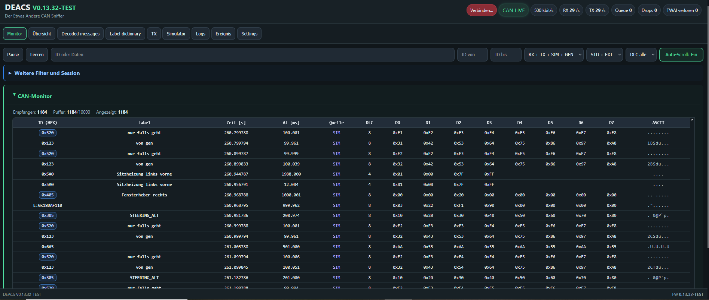
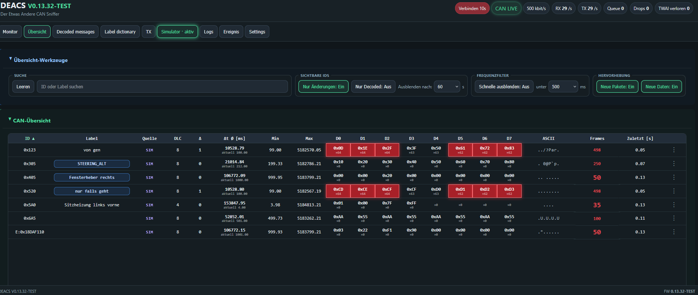
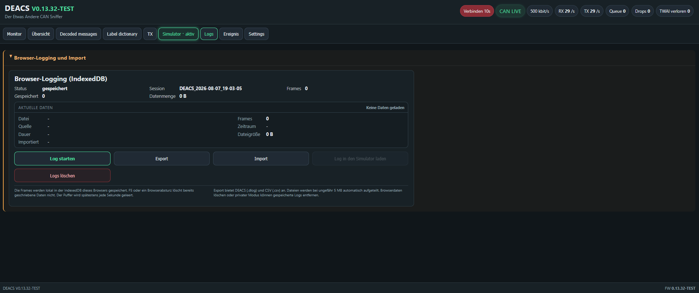
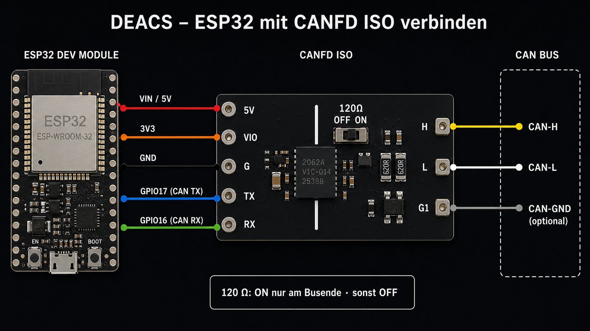

# DEACS V0.13.63-TEST

**Deutsch** | [English](README_EN.md)

Test-Repository auf dem aktuellen DEACS-Funktionsstand. Zielhardware: **ESP32-S3 N16R8**, Upload und Monitor: **COM9**. Die neuen BIN-Dateien sind nicht für den bisherigen ESP32-WROOM vorgesehen.

Die Oberfläche unterstützt Deutsch, Englisch und Japanisch. Die Auswahl **DE / EN / JA** rechts in der Tab-Leiste schaltet ohne Neuladen um und wird im Browser sowie in Settings-Dateien gespeichert. CAN-Daten, eigene Labels und Dateinamen bleiben unverändert.

**Der Etwas Andere CAN Sniffer** ist ein browserbasiertes CAN-Werkzeug für den ESP32. Es empfängt, analysiert, protokolliert, simuliert und sendet klassische CAN-Frames über den internen TWAI-Controller des ESP32.








## Funktionen

- Live-Monitor für Standard- und Extended-CAN-Frames
- Übersicht mit Änderungs-, Decoded- und Frequenzfiltern
- DBC-Decodierung und verwaltbares Label Dictionary
- Einzelne und zyklische TX-Frames
- Simulator, Generator und Log-Wiedergabe
- Optionales Live-Senden von Simulator, Generator und Log-Wiedergabe
- CAN-Filter zum gezielten Anzeigen oder Ausblenden mehrerer IDs
- Browser-Logging mit Export als DEACS-Log (`.dlog`) oder CSV
- Ereignis-Analyse mit Markern, Zeitfenstern sowie Vorher-/Nachher-Vergleich
- Globale ID-Anzeige in Hexadezimal oder Dezimal; Hexwerte werden mit kleinem `0x` dargestellt
- Diagnoseanzeigen für CAN-Status, Queue, Drops, TWAI-Fehler und fehlendes ACK

## Hardware

- ESP32-S3 N16R8 (16 MB Flash, 8 MB Octal-PSRAM)
- Externer 3,3-V-kompatibler CAN-Transceiver
- Der ESP32 verwendet seinen internen TWAI-Controller; ein MCP2515 wird nicht benötigt.

| Signal | ESP32-Pin |
|---|---:|
| CAN TX | GPIO 17 |
| CAN RX | GPIO 16 |
| Aktivitäts-LED | GPIO 2 |

Der CAN-Bus muss passend terminiert sein. Üblich sind 120 Ohm an beiden Busenden.

### WeAct Studio ISOCANFD Module V1 anschließen



Das gezeigte Board verwendet den isolierten CAN-FD-Transceiver **CA-IS2062A**. Laut Herstellerangabe unterstützt es bis zu **5 Mbit/s**, eine Logikspannung `VIO` von **2,5–5,5 V**, eine Versorgung von **4,5–5,5 V** und eine Isolation von **2,5 kV**. DEACS verwendet davon klassische CAN-Übertragung bis 1 Mbit/s.

| ESP32 | CANFD ISO | Funktion |
|---|---|---|
| VIN / 5V | 5V | Versorgung des Transceiver-Boards |
| 3V3 | VIO | 3,3-V-Logikpegel für den ESP32 |
| GND | G | Masse der ESP32-Seite |
| GPIO 17 | TX | CAN-Sendedaten vom ESP32 |
| GPIO 16 | RX | CAN-Empfangsdaten zum ESP32 |
| – | H | CAN-H des Busses |
| – | L | CAN-L des Busses |
| – | G1 | optionale CAN-Bus-Bezugsmasse |

`G` und `G1` gehören zu den beiden getrennten Seiten des Moduls und dürfen für den isolierten Betrieb nicht miteinander verbunden werden. Den 120-Ω-Schalter nur einschalten, wenn DEACS an einem Ende des CAN-Busses sitzt und dort noch kein Abschlusswiderstand vorhanden ist.

Ausführliche Hinweise: [WeAct Studio ISOCANFD Module V1 verwenden](docs/CANFD_ISO_BOARD.md).

## CAN-Modi

- **Nur Mithören:** empfängt Frames und hält den Transceiver-TX-Ausgang rezessiv.
- **Normal / TX:** sendet nur mit ACK. Fehlt ein weiterer aktiver CAN-Teilnehmer, wird der Fehler in der Oberfläche angezeigt.
- **TX ohne ACK:** ermöglicht Tests ohne weiteren CAN-Teilnehmer. Dieser Modus ist für Prüfaufbauten gedacht.

Die Board-LED zeigt erfolgreiche Live-Sendungen auf dem CAN-Bus an. Reine Simulator- oder Generator-Daten ohne Live-TX lösen sie nicht aus.

## Installation und Upload

Benötigt werden [Visual Studio Code](https://code.visualstudio.com/) und [PlatformIO](https://platformio.org/).

1. Repository öffnen.
2. ESP32 per USB verbinden.
3. In VS Code den Standard-Build-Task **DEACS: Upload komplett** starten.

Der Task baut die Firmware und überträgt anschließend Firmware und LittleFS-Weboberfläche. Alternativ:

```text
pio run
pio run -t upload
pio run -t uploadfs
```

Nach Änderungen an Dateien unter `data/` muss auch LittleFS erneut hochgeladen werden.

### ESP32-S3-N16R8

Die Standardumgebung `esp32s3_n16r8` verwendet ein ESP32-S3-DevKitC-kompatibles N16R8-Board mit 16 MB Flash und 8 MB Octal-PSRAM. Der klassische ESP32 wird nicht mehr unterstützt.

```text
pio run -e esp32s3_n16r8
pio run -e esp32s3_n16r8 -t buildfs
pio run -e esp32s3_n16r8 -t upload
pio run -e esp32s3_n16r8 -t uploadfs
```

CAN-TX bleibt GPIO17, CAN-RX GPIO16. Beim S3 muss **GPIO21 unbeschaltet bleiben**, da dieser statt GPIO27 als Listen-only-Dummy-TX verwendet wird. GPIO27 ist beim S3 für den Speicher reserviert.

Die Aktivitätsanzeige bleibt ein digitaler Ausgang auf GPIO2 und benötigt beim S3 eine externe LED mit Vorwiderstand; eine adressierbare Onboard-RGB-LED wird damit nicht angesteuert. Upload und serieller Monitor verwenden standardmäßig UART über den USB-UART-Anschluss des Boards.

Alle Upload-Skripte und der Web-Flasher-BIN-Task verwenden `esp32s3_n16r8`.

### Komplettes BIN für den Browser-Flasher erstellen

Der zusätzliche VS-Code-Task **DEACS: Web-Flasher BIN erstellen** baut Firmware und LittleFS und verbindet anschließend alle benötigten Bestandteile zu einer einzigen Datei:

`release/DEACS_V0_13_63_TEST_webflash.bin`

Der bisherige Task **DEACS: Upload komplett** bleibt unverändert.

### Mit esptool-js flashen

1. Die Datei [`DEACS_V0_13_63_TEST_webflash.bin`](release/DEACS_V0_13_63_TEST_webflash.bin) herunterladen.
2. [Espressif ESP Tool](https://espressif.github.io/esptool-js/) in Chrome oder Edge öffnen. Safari wird nicht unterstützt.
3. ESP32 per USB verbinden und **Connect** wählen.
4. Unter **Program** die heruntergeladene Datei auswählen.
5. Als Flash-Adresse `0x0` eintragen.
6. **Program** starten und warten, bis das Schreiben abgeschlossen ist.
7. Den ESP32 neu starten und mit dem WLAN `DEACS` verbinden.

Das Gesamt-BIN enthält Bootloader, Partitionstabelle, Firmware und die vollständige LittleFS-Weboberfläche. Es darf deshalb ausschließlich an Adresse `0x0` geflasht werden.

## Erster Start

### USB bevorzugen

Ab **0.13.41-TEST** verwendet DEACS die serielle Schnittstelle direkt im Browser. Ein externes Programm oder lokaler Server ist nicht erforderlich.

1. Die vollständige [USB-Oberfläche herunterladen](release/DEACS_V0_13_63_TEST_USB.html), oder in der WLAN-Oberfläche **USB-Oberfläche speichern** wählen.
2. Die HTML-Datei lokal in **Chrome oder Edge** öffnen.
3. ESP32 anschließen, **USB verbinden** wählen und den DEACS-Port im Browser freigeben.

Eine bestätigte USB-Verbindung hat Vorrang. Bereits freigegebene, eindeutig zuordenbare Ports werden beim erneuten Anstecken wieder verbunden. Die Oberfläche zeigt **USB verbunden** beziehungsweise **WLAN verbunden**. Uploadprogramme und seriellen Monitor vorher schließen. Unter unverschlüsseltem `http://192.168.4.1` ist Web Serial im Browser normalerweise nicht verfügbar; deshalb gibt es die lokale HTML-Datei.

`esp32s3_n16r8` verwendet USB-UART mit **921600 Baud**. Für den nativen USB-Anschluss des S3 die Umgebung `esp32s3_n16r8_usb` verwenden. Firmware und LittleFS müssen zum neuen Stand passen. Weitere Hinweise und WLAN-Rückfall: [USB-Verbindung](docs/USB.md).

### Direkt über WLAN

Der ESP32 stellt einen eigenen WLAN-Access-Point bereit:

| Einstellung | Wert |
|---|---|
| WLAN | `DEACS` |
| Passwort | `deacs123` |
| Weboberfläche | `http://192.168.4.1` |

Nach dem Verbinden mit dem WLAN die Weboberfläche im Browser öffnen.

## Bedienbereiche

### BMW-E90-Tacho-Demo

Im Tab **BMW E90** startet **Tacho-Demo starten** eine wiederholte Zeigerfahrt mit wechselnden Blinkern und Kontrollleuchten. Tank und Kühlmittel liegen unter der Demo-Anzeige. Der Tank leert sich während des Motorlaufs in etwa 70 Sekunden; **Reset** setzt ihn wieder auf voll. **Demo halten / fortsetzen** pausiert die Animation, während die Zündungsnachrichten weiterlaufen. **Stop** sendet die Ausschaltbefehle.

Für einen realen Tacho unter **Settings** die Option **BMW E90 live auf CAN senden** aktivieren. Beim Start wird CAN auf **100 kbit/s, TX ohne ACK** gestellt und die Geräteantwort geprüft. Ohne diese Option erscheinen die Frames ausschließlich im Monitor. Die Demo wird im Browser erzeugt; das Fenster muss geöffnet und im Vordergrund bleiben. Welche Warnsymbole erscheinen und wie schnell der Tank reagiert, hängt vom Kombiinstrument ab.

Die Oberfläche unterstützt Deutsch, Englisch und Japanisch. Weitere Protokoll- und Prüfhinweise stehen in den [Release-Notizen](release/DEACS_V0_13_63_TEST_NOTES.md).

- **Monitor:** fortlaufende Frame-Liste mit Suche, Filtern, Pause und Auto-Scroll
- **Übersicht:** eine Zeile je CAN-ID mit Zykluszeiten und Byte-Änderungen
- **Decoded messages:** DBC-decodierte Signale
- **Label dictionary:** eigene Bezeichnungen für CAN-IDs importieren, exportieren und bearbeiten
- **TX:** einzelne oder zyklische Frames konfigurieren
- **Simulator:** Frames erzeugen, importierte Logs abspielen und Generatoren verwalten
- **Logs:** Aufzeichnung, Import, Wiedergabe und Export
- **Ereignis:** Marker setzen und Änderungen vor und nach einem Ereignis vergleichen
- **Settings:** Bitrate, Betriebsart, ID-Darstellung, Live-TX-Quellen, CAN-Filter und DBC-Dateien

## DBC-Dateien

### Speicherbudget

Wachsende Nutzdatenlisten verwenden ein gemeinsames 80-%-Budget je Speicherbereich. Der ESP32-Simulator nutzt PSRAM bevorzugt und ist nicht mehr auf 16 Einträge begrenzt. Browserlisten, Importe und Logging prüfen ihre eigenen Budgets. Browser-Schätzungen sind in der Diagnose gekennzeichnet. Verhalten an der Grenze und verbleibende technische Grenzen stehen unter [Speicherverwaltung](docs/MEMORY.md).

DBC-Dateien können in den Einstellungen direkt hinzugefügt, ausgewählt und gelöscht werden. Sie werden im LittleFS des ESP32 gespeichert. Manuelle Einträge im Label Dictionary haben Vorrang vor DBC-Namen.

## Einstellungen als Datei sichern

Unter **Settings → Settings speichern** wird eine versionierte JSON-Datei (`DEACS-Settings`, Version 1) heruntergeladen. Sie enthält CAN-Bitrate und -Modus, Server- und Monitorfilter, Häkchen, Anzeige- und Wiedergabeoptionen, Generatorparameter, Eingabeentwürfe, DBC-Auswahl und -Aktivierung, Simulator-Liste, Labels, Decoded-Definitionen sowie den Aufklappzustand der Funktionsbereiche. Aufgezeichnete CAN-Daten und die DBC-Dateien selbst sind nicht enthalten.

**Settings laden** prüft die Datei und fragt vor dem Ersetzen nach. Simulator, Generator, Wiedergabe und TX-Zyklus werden gestoppt; der Import startet keine dieser Aktionen. Bei bestehender Verbindung werden CAN-Bitrate, Modus und Serverfilter auf den ESP32 übertragen. Offline bleiben diese Geräteeinstellungen vorgemerkt und können nach dem Verbinden über **Geräteeinstellungen anwenden** übernommen werden. Bei einem Übertragungsfehler bleibt diese Aktion für einen erneuten Versuch verfügbar. Fehlende DBC-Dateien werden gemeldet und müssen separat hinzugefügt werden.

## Simulator-Wiederholung

Der Simulator besitzt eine eigene Auswahl **Wiederholung: Einmalig / Endlos**. Einmalig erzeugt jeden aktivierten Frame genau einmal nach seinem eingestellten Intervall und stoppt anschließend automatisch. Endlos wiederholt die Frames im jeweiligen Intervall bis zum Stoppen. Die Auswahl wird im Browser gespeichert und gilt sowohl im Browser- als auch im ESP32-Simulator.

Die Log-Wiedergabe besitzt unabhängig davon **Endlos wiederholen** (standardmäßig eingeschaltet). Ohne Wiederholung endet sie nach einem Durchlauf. Die 80-%-Speichergrenzen für Monitor und Logging gelten für beide Bereiche.

## Ereignis-Analyse

Die Analyse verwendet die Daten des aktuellen Monitors und speichert beim Setzen eines Markers dessen Quelle. Für ein einstellbares Zeitfenster vor und nach dem Marker werden geänderte IDs, Bytes und Bitpositionen ermittelt. Gleiche Daten oder zyklische Nachrichten können ausgeblendet werden.

## Projektstruktur

| Pfad | Inhalt |
|---|---|
| `src/` | ESP32-Firmware |
| `include/` | Konfiguration und Header |
| `data/` | Weboberfläche und LittleFS-Inhalte |
| `data/dbc/` | mitgelieferte DBC-Dateien |
| `docs/` | Hardware-, API- und Stil-Dokumentation |

Weitere Details: [Hardware](docs/HARDWARE.md), [API](docs/API.md) und [DEACS Styleguide](docs/DEACS_STYLEGUIDE.md).

## 🍺 Projekt unterstützen

DEACS hilft dir? Dann kannst du mir über PayPal ein Bier ausgeben:

[🍺 Ein Bier für DEACS ausgeben](https://paypal.me/braintechnology)

## Danksagung

DEACS baut auf der Arbeit zahlreicher Open-Source-Projekte und ihrer Mitwirkenden auf. Besonderer Dank gilt:

- [Espressif ESP-IDF](https://github.com/espressif/esp-idf) für die ESP32-Plattform, den TWAI-Treiber, Wi-Fi und LittleFS
- [Arduino Core for the ESP32](https://github.com/espressif/arduino-esp32) als Firmware-Framework
- [PlatformIO](https://github.com/platformio/platformio-core) für Build, Abhängigkeitsverwaltung und Upload
- [arduinoWebSockets](https://github.com/Links2004/arduinoWebSockets) von Markus Sattler und allen Mitwirkenden für die WebSocket-Kommunikation
- [adamtheone/canDrive](https://github.com/adamtheone/canDrive), insbesondere `01_canSniffer_Arduino`, als Referenz für CAN-Sniffer, Simulation und Analyse
- [ludwig-v/arduino-psa-diag](https://github.com/ludwig-v/arduino-psa-diag) für grundlegende Arbeiten zur PSA-/Stellantis-Diagnose über CAN
- [Barracuda09/PyPSADiag](https://github.com/Barracuda09/PyPSADiag) für die weiterführende PSA-/Stellantis-Diagnose und als fachliche Referenz
- den Autoren und Mitwirkenden der verwendeten beziehungsweise referenzierten DBC-Dateien und CAN-Dokumentationen

Alle Namen und Marken gehören ihren jeweiligen Inhabern. Für eingebundene Drittinhalte gelten die jeweiligen Lizenzen und Nutzungsbedingungen der Ursprungsprojekte.

## Sicherheit

Das Senden beliebiger CAN-Frames kann Steuergeräte und Fahrzeugfunktionen beeinflussen. DEACS nur an geeigneten Testaufbauten oder mit vollständigem Verständnis des angeschlossenen Systems verwenden. Für Schäden durch unsachgemäßen Einsatz wird keine Haftung übernommen.
