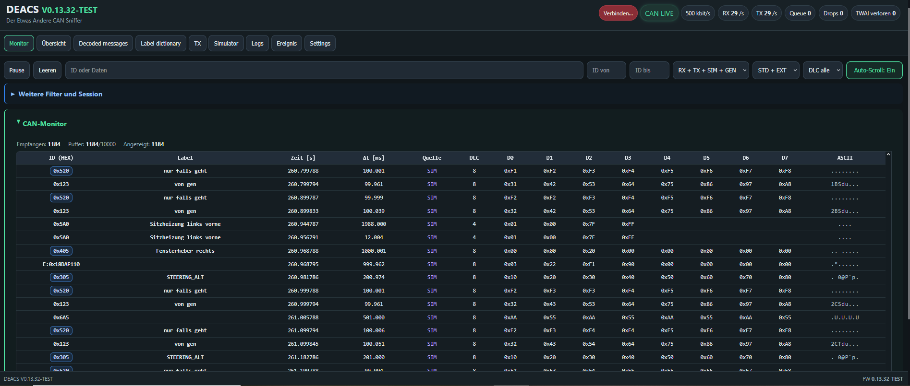
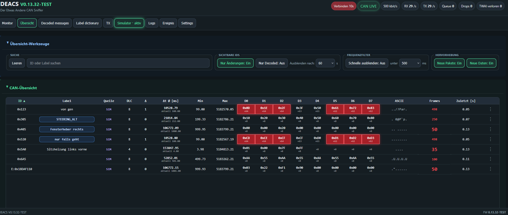
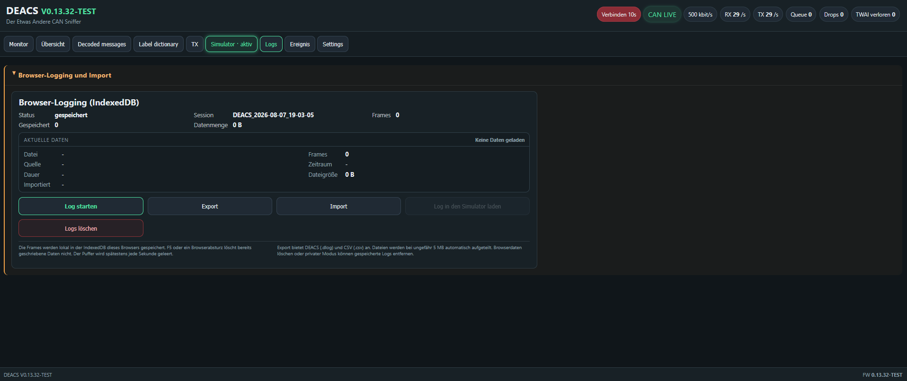
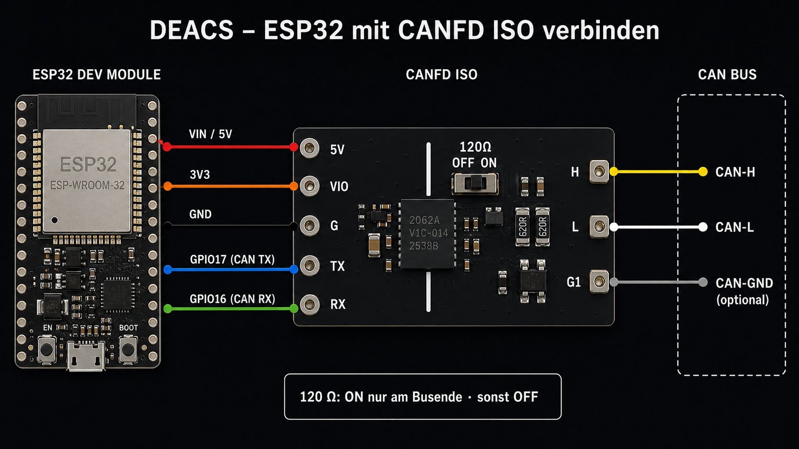

# DEACS V0.13.32-TEST

[Deutsch](README.md) | **English**

**Der Etwas Andere CAN Sniffer** (The Slightly Different CAN Sniffer) is a browser-based CAN tool for the ESP32. It receives, analyzes, logs, simulates, and transmits classic CAN frames using the ESP32's internal TWAI controller.

> This is a TEST version. Use special care when actively transmitting on a vehicle CAN bus.







## Features

- Live monitor for standard and extended CAN frames
- Overview with change, decoded-message, and frequency filters
- DBC decoding and a manageable label dictionary
- Single and cyclic TX frames
- Simulator, generator, and log playback
- Optional live CAN transmission from simulator, generator, and log playback
- CAN filter for showing or hiding multiple IDs
- Browser logging with DEACS log (`.dlog`) or CSV export
- Event analysis with markers, time windows, and before/after comparison
- Global hexadecimal or decimal ID display; hexadecimal values use a lowercase `0x` prefix
- Diagnostics for CAN state, queue, drops, TWAI errors, and missing ACK

## Hardware

- ESP32 Dev Module / ESP32-WROOM-32D
- External 3.3 V-compatible CAN transceiver
- DEACS uses the ESP32's internal TWAI controller; no MCP2515 is required.

| Signal | ESP32 pin |
|---|---:|
| CAN TX | GPIO 17 |
| CAN RX | GPIO 16 |
| Activity LED | GPIO 2 |

The CAN bus must be terminated correctly. A 120-ohm resistor is normally used at each end of the bus.

### Connecting the WeAct Studio ISOCANFD Module V1



The illustrated board uses the isolated **CA-IS2062A** CAN FD transceiver. According to the manufacturer, it supports up to **5 Mbit/s**, a `VIO` logic supply of **2.5–5.5 V**, a **4.5–5.5 V** supply, and **2.5 kV** isolation. DEACS uses it for classic CAN communication at up to 1 Mbit/s.

| ESP32 | CANFD ISO | Function |
|---|---|---|
| VIN / 5V | 5V | Transceiver-board supply |
| 3V3 | VIO | 3.3 V logic level for the ESP32 |
| GND | G | ESP32-side ground |
| GPIO 17 | TX | CAN transmit data from the ESP32 |
| GPIO 16 | RX | CAN receive data to the ESP32 |
| – | H | CAN-H |
| – | L | CAN-L |
| – | G1 | Optional CAN-bus reference ground |

`G` and `G1` belong to the two isolated sides of the module and must not be connected for isolated operation. Enable the 120-ohm switch only when DEACS is located at one end of the CAN bus and no termination resistor is already installed there.

Detailed instructions: [Using the WeAct Studio ISOCANFD Module V1](docs/CANFD_ISO_BOARD.md) (German).

## CAN modes

- **Listen-only:** receives frames and keeps the transceiver TX output recessive.
- **Normal / TX:** transmits only with ACK. If no other active CAN node is present, the interface displays an error.
- **TX without ACK:** enables tests without another CAN node. This mode is intended for test benches.

The board LED indicates successful live transmissions on the CAN bus. Simulator or generator data without live TX does not trigger it.

## Installation and upload

[Visual Studio Code](https://code.visualstudio.com/) and [PlatformIO](https://platformio.org/) are required.

1. Open the repository.
2. Connect the ESP32 via USB.
3. Run the default VS Code build task **DEACS: Upload komplett**.

The task builds and uploads both the firmware and the LittleFS web interface. Alternatively:

```text
pio run
pio run -t upload
pio run -t uploadfs
```

After changing files under `data/`, upload LittleFS again.

### Creating a complete BIN for browser flashing

The additional VS Code task **DEACS: Web-Flasher BIN erstellen** builds the firmware and LittleFS and combines all required components into one file:

`release/DEACS_V0_13_32_TEST_webflash.bin`

The existing **DEACS: Upload komplett** task remains unchanged.

### Flashing with esptool-js

1. Download [`DEACS_V0_13_32_TEST_webflash.bin`](release/DEACS_V0_13_32_TEST_webflash.bin), or create it locally with **DEACS: Web-Flasher BIN erstellen**.
2. Open the [Espressif ESP Tool](https://espressif.github.io/esptool-js/) in Chrome or Edge. Safari is not supported.
3. Connect the ESP32 via USB and select **Connect**.
4. Under **Program**, select the downloaded file.
5. Enter `0x0` as the flash address.
6. Select **Program** and wait for the write operation to finish.
7. Restart the ESP32 and connect to the `DEACS` Wi-Fi network.

The combined BIN contains the bootloader, partition table, firmware, and complete LittleFS web interface. It must therefore be flashed only at address `0x0`.

## First start

The ESP32 provides its own Wi-Fi access point:

| Setting | Value |
|---|---|
| Wi-Fi | `DEACS` |
| Password | `deacs123` |
| Web interface | `http://192.168.4.1` |

After connecting to the Wi-Fi network, open the web interface in a browser.

## Interface sections

- **Monitor:** continuous frame list with search, filters, pause, and auto-scroll
- **Overview:** one row per CAN ID with cycle times and byte changes
- **Decoded messages:** DBC-decoded signals
- **Label dictionary:** import, export, and edit custom CAN-ID names
- **TX:** configure single or cyclic frames
- **Simulator:** generate frames, play imported logs, and manage generators
- **Logs:** recording, import, playback, and export
- **Event:** set markers and compare changes before and after an event
- **Settings:** bitrate, operating mode, ID display, live-TX sources, CAN filters, and DBC files

## DBC files

DBC files can be added, selected, and deleted directly in Settings. They are stored in the ESP32's LittleFS. Manual label-dictionary entries take precedence over DBC names.

## Event analysis

The analysis uses data from the current monitor and records its source when a marker is set. It identifies changed IDs, bytes, and bit positions in a configurable time window before and after the marker. Identical data or cyclic messages can be hidden.

## Project structure

| Path | Contents |
|---|---|
| `src/` | ESP32 firmware |
| `include/` | Configuration and headers |
| `data/` | Web interface and LittleFS contents |
| `data/dbc/` | Included DBC files |
| `docs/` | Hardware, API, and style documentation |

More details: [Hardware](docs/HARDWARE.md), [API](docs/API.md), and [DEACS style guide](docs/DEACS_STYLEGUIDE.md) (German).


## Acknowledgements

DEACS builds on the work of many open-source projects and contributors. Special thanks go to:

- [Espressif ESP-IDF](https://github.com/espressif/esp-idf) for the ESP32 platform, TWAI driver, Wi-Fi, and LittleFS
- [Arduino Core for the ESP32](https://github.com/espressif/arduino-esp32) as the firmware framework
- [PlatformIO](https://github.com/platformio/platformio-core) for building, dependency management, and uploading
- [arduinoWebSockets](https://github.com/Links2004/arduinoWebSockets) by Markus Sattler and its contributors for WebSocket communication
- [adamtheone/canDrive](https://github.com/adamtheone/canDrive), especially `01_canSniffer_Arduino`, as a reference for CAN sniffing, simulation, and analysis
- [ludwig-v/arduino-psa-diag](https://github.com/ludwig-v/arduino-psa-diag) for foundational PSA/Stellantis diagnostics over CAN
- [Barracuda09/PyPSADiag](https://github.com/Barracuda09/PyPSADiag) for further PSA/Stellantis diagnostics and technical reference
- the authors and contributors of the included or referenced DBC files and CAN documentation

All names and trademarks belong to their respective owners. Third-party content is subject to the licenses and terms of its original project.

## Safety

Transmitting arbitrary CAN frames can affect control units and vehicle functions. Use DEACS only on suitable test setups or with a complete understanding of the connected system. No liability is accepted for damage caused by improper use.
