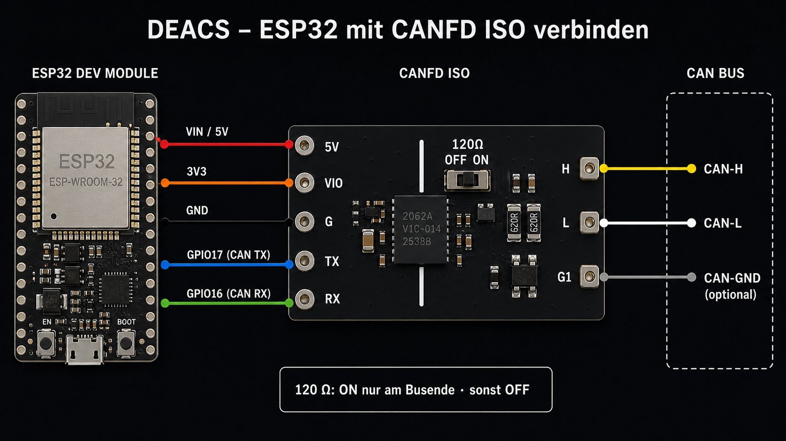

# WeAct Studio ISOCANFD Module V1 mit DEACS verwenden

Stand: **DEACS V0.13.63-TEST**

Diese Anleitung gilt für das **WeAct Studio ISOCANFD Module V1** mit **CA-IS2062A** und den Anschlüssen `5V`, `VIO`, `G`, `TX`, `RX` auf der ESP32-Seite sowie `H`, `L`, `G1` auf der CAN-Seite.

## Board-Daten

| Eigenschaft | Herstellerangabe |
|---|---|
| Transceiver | CA-IS2062A |
| Maximale Datenrate | 5 Mbit/s |
| VIO für RX und TX | 2,5–5,5 V |
| Versorgung 5V | 4,5–5,5 V |
| Isolation | 2,5 kV |
| Abschlusswiderstand | 120 Ω, schaltbar |

DEACS verwendet ausschließlich klassischen CAN mit dem ESP32-TWAI-Controller. Unterstützt werden 25, 50, 100, 125, 250 und 500 kbit/s sowie 1 Mbit/s. Die CAN-FD-Fähigkeit des Transceivers macht den ESP32-TWAI-Controller nicht CAN-FD-fähig; CAN-FD-Datenphasen können daher nicht dekodiert oder erzeugt werden.

## Verdrahtung

| ESP32-S3 N16R8 | CANFD ISO | Hinweis |
|---|---|---|
| VIN beziehungsweise 5V | 5V | Versorgung vom USB-gespeisten ESP32-Board |
| 3V3 | VIO | stellt die Logikseite auf sichere 3,3 V |
| GND | G | Masse der Logikseite |
| GPIO 17 | TX | TWAI-TX von DEACS zum Transceiver |
| GPIO 16 | RX | Empfangssignal vom Transceiver zu DEACS |
| GPIO 21 | nicht verbinden | interner Dummy-TX für die sichere Listen-only-Trennung |
| nicht verbinden | H | mit CAN-H des Busses verbinden |
| nicht verbinden | L | mit CAN-L des Busses verbinden |
| nicht mit ESP32-GND verbinden | G1 | bei Bedarf mit CAN-GND beziehungsweise Bus-Bezugsmasse verbinden |

Wichtig: `VIO` wird mit `3V3` verbunden, nicht mit `5V`. Dadurch liefert der RX-Ausgang keine 5-V-Logik an den ESP32. GPIO21 bleibt vollständig unbeschaltet.

## Galvanische Trennung

Die weiße Trennlinie auf dem Modul kennzeichnet die Isolationsbarriere. `G` ist die Masse der ESP32-Seite, `G1` die Bezugsmasse der CAN-Seite. Eine direkte Verbindung zwischen `G` und `G1` hebt die galvanische Trennung auf.

CAN-H und CAN-L reichen für viele zweidrahtige Testaufbauten aus. `G1` kann zusätzlich mit der Bus-Bezugsmasse verbunden werden, wenn der angeschlossene Aufbau dies vorsieht. Nicht mit Schirmung oder Fahrzeugkarosserie verwechseln, sofern deren Funktion nicht eindeutig bekannt ist.

## 120-Ω-Abschluss

Der Schiebeschalter aktiviert den auf dem Modul eingebauten 120-Ω-Abschlusswiderstand:

- **ON:** DEACS sitzt physisch an einem Busende und dort fehlt noch der Abschluss.
- **OFF:** DEACS sitzt in der Mitte des Busses oder beide Busenden sind bereits abgeschlossen.

Bei ausgeschalteter Versorgung sollte zwischen CAN-H und CAN-L ungefähr 60 Ω messbar sein, wenn ein korrekt aufgebauter Bus an beiden Enden jeweils 120 Ω besitzt.

## In DEACS verwenden

1. ESP32 und CANFD-ISO-Board spannungsfrei verdrahten.
2. CAN-H, CAN-L und gegebenenfalls G1 mit dem Bus verbinden.
3. Abschlusswiderstand passend zur Position des Moduls einstellen.
4. ESP32 einschalten, mit dem WLAN `DEACS` verbinden und `http://192.168.4.1` öffnen.
5. In **Settings** die Bitrate des angeschlossenen CAN-Busses auswählen.
6. Für passives Beobachten **Nur Mithören** verwenden.
7. Zum Senden **Normal / TX** verwenden. Ohne weiteren bestätigenden Teilnehmer entsteht kein ACK; für einen isolierten Prüfaufbau kann gezielt **TX ohne ACK** gewählt werden.

Im Listen-only-Modus hält DEACS GPIO17 dauerhaft rezessiv und leitet das interne TWAI-TX-Signal auf den unbeschalteten GPIO21 um. Weitere technische Details stehen in [HARDWARE.md](HARDWARE.md).

## Sicherheit

Die Verdrahtung niemals bei eingeschalteter Versorgung ändern. Vor dem Anschluss an ein Fahrzeug zuerst Pinbelegung, Bitrate, Spannungen und Terminierung prüfen. Bei unbekannten Netzen zunächst ausschließlich **Nur Mithören** verwenden. Das Senden unbekannter Frames kann Steuergeräte oder sicherheitsrelevante Fahrzeugfunktionen beeinflussen.
